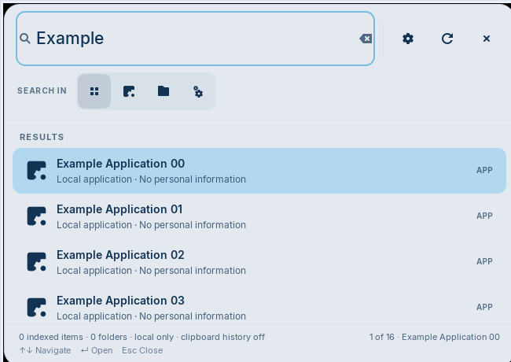
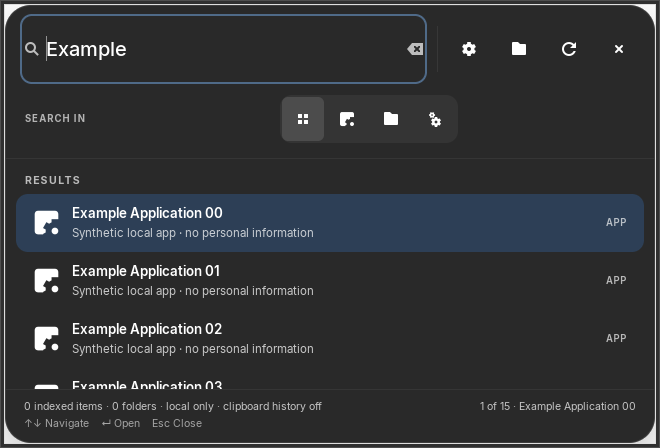

# GoreeCloud Index

**Linux-first, local-first desktop search and action palette.**
**Status: v0.1.0 development preview — not Stable, not a published installer.**

GoreeCloud Index is a first-party native GTK4/libadwaita desktop application for
discovering installed applications, searching explicitly selected folders, opening
results, performing safe calculations, and refreshing a private local search index.
No GoreeCloud account, telemetry, server, or external search provider is required.

## Implemented today

- **Spotlight-inspired floating GTK4/libadwaita search palette:** a compact,
  undecorated rounded panel with a large search field, subtle semantic
  translucency, inline icon filters (All / Apps / Files / Actions), and
  a clean scrollable results list with installed applications' native icons.
  Distinct Preferences and indexed-folder permission controls keep cosmetic
  settings separate from privacy consent; refresh and close remain explicit.
  It does not include Apple assets or a global system shortcut.
  **Normal window by default:** the GTK palette starts as a resizable,
  non-maximized, non-full-screen desktop window, normally 660×448.
  On smaller displays it scales down to 90% of the smallest valid logical
  monitor dimensions across all attached displays, with a tested 390×300
  compact-layout floor. Monitor enumeration order does not decide the size.
  GDK4 monitor geometry is not guaranteed to exclude desktop panels, and
  the compositor retains final placement control. This is not universal
  GNOME/KDE/device acceptance. Native GTK smoke tests check the startup
  policy under isolated Xvfb and hosted private Weston Wayland.
- Up/Down selects results without losing search focus; Enter opens the
  selected result. Result rows and selection/status feedback expose
  accessible names and roles. Clipboard history remains off.
- Native Preferences window with **Light by default** on a first launch,
  explicit saved Dark or Auto/Follow system modes, and Reset to Light. The
  choice is retained only in the existing private Index SQLite database;
  selecting Auto is optional and does not change host-wide desktop settings.
- Application listing and launching through Gio/freedesktop app registry.
- Identity-bound consent for each authorized root (filesystem device + inode);
  stored search hits are hidden if a root is replaced or unbound.
- Before returning an in-flight file search, Index rechecks the root's
  stored consent and metadata, returned items and folder exclusions. Detected
  mid-query revocation, content downgrade, exclusion or clearing suppresses
  stale results rather than exposing cached filenames or text snippets.
- Explicit reauthorization in GTK or CLI resets the root to metadata-only and
  clears the old index/exclusions, without touching original files.
- Indexed files and folders are pinned to their own device/inode. Regular
  files additionally record Linux ctime, mtime, and size at scan time. If a
  file is edited or replaced in place, opening it is refused until a manual
  rescan refreshes the approved metadata. These secondary checks mitigate rare
  inode reuse, but do not cryptographically prove filesystem identity. Legacy
  database rows missing ctime stay hidden until rescanned. Source files are
  never changed by Index.
- Selected indexed files are opened through verified Linux `O_PATH`
  descriptors and freedesktop `OpenURI.OpenFile` over the session D-Bus.
  Passing the pinned FD instead of a pathname prevents Index's earlier
  pathname-substitution race. The system portal and its backend are required;
  failures never trigger an insecure pathname-URI fallback. Real portal
  backend and third-party handler FD semantics remain a Stable-release gate.
- File results that are executable, `.desktop` launchers, or common script/
  program formats remain searchable but will **not** launch from Index: use
  the file manager to inspect them intentionally. This prevents automatic
  handoff to a potentially executing file handler, without reading content,
  modifying original files, or disabling normal installed-app launching.
  It is defense in depth, not a guarantee about every custom file handler.
- Consent-based indexing of named local directories with SQLite FTS5.
- Native indexed-folder manager that shows approved roots and their content
  access level, with confirmation before revoking access and deleting index data.
- Per-folder text indexing consent can be enabled or changed back to metadata-only
  in the GTK interface or CLI; a downgrade immediately purges retained text.
- Approved roots can exclude individual subfolders from indexing, managed through
  GTK or CLI. Adding an exclusion immediately deletes matching local index
  results without touching source files; removing it requires a manual rescan.
- New folders added through the GTK picker start **metadata-only**; enabling
  file-content indexing requires a second explicit per-root confirmation in
  Manage indexed folders. Optional text extraction remains bounded to supported
  small UTF-8-ish source and document formats.
- Search terms and basic `kind:`, `ext:`, and `path:` filters. Recognized filters reject blank, overlong, repeated or unsupported values; searches with more than 12 words return an error instead of silently ignoring constraints.
- Sandboxed arithmetic, percentages, temperature and offline unit conversions.
- Submit indexed file/folder descriptors to the user-mediated desktop
  portal, with no local shell or insecure pathname-based fallback.
- Manual rescans with final root-inode verification before stale-entry reconciliation, revocation-aware scan permissions,
  privacy-oriented exclusions, descriptor-anchored Linux file traversal with
  inode checks against mid-scan symlink swaps, owner-only data-directory
  permissions, and a local CLI.
- Core unit tests and Linux CI gates.
- A local CLI `doctor` command checks SQLite quick-check consistency and
  whether selected roots still match their authorized filesystem identities;
  `--json` provides machine-readable health status. The diagnostic is not a
  full FTS, filesystem, security or release-readiness audit, and it neither
  rescans nor expands indexing permissions.
- Reproducible, rootlessly assembled Debian/Ubuntu .deb development package.
- Offline disposable-container dpkg install/upgrade/rollback/purge lifecycle validation
  (dependency checks intentionally bypassed; not distro acceptance).
- GitHub-hosted disposable Ubuntu 24.04 apt acceptance gate for a real
  dependency-checked install, installed GTK smoke, upgrade, downgrade and purge;
  it never installs the package on the owner's laptop.
- Index database symlink and hard-link protections, plus database inode checks on subsequent SQLite connections; these are conservative preflight checks, not a race-free SQLite filesystem sandbox. Overlapping search roots are prohibited.

Not yet implemented: PDF/OCR extraction, file monitoring, content provider
plugins, remote/cloud search, AI, Quick Keys, global hotkeys, clipboard capture
or history, advanced workflows, and Windows application support.

## Keyboard controls and accessibility

Use **↑ / ↓** while typing in the search field to move through matching
results without losing typing focus; the highlighted item scrolls into view
when the list is laid out. Typing updates matches immediately. **Enter** opens the highlighted result;
**Ctrl+1–4** switches search modes; **Escape** clears the query, or closes
the window when the search is empty. GTK SearchEntry's native `stop-search`
signal is handled explicitly, so Escape works even when the search field
consumes the key event before the window controller.

The floating palette has compact icon-only mode buttons with accessible
names and tooltips. Use Preferences to change the local appearance and
Manage indexed folders to edit explicit filesystem consent; refresh and close
buttons remain keyboard accessible. The window is draggable through its native
GTK handle. The first-launch **Light** scheme overrides the OS preference;
user-saved Dark stays dark, while **Auto** follows the desktop preference. True compositor background blur, global Spotlight-style invocation,
window placement across Wayland compositors and Apple feature parity are **not**
claimed.

Native GTK CI checks now cover real isolated X11 key delivery, keyboard
selection, accessible result roles and dynamic **100% / 200% / 400% GTK system
text scaling** at compact 390/440 px widths. Native font-relative typography
and a reflowing filter strip keep the floating palette from expanding
horizontally. At large text sizes, nonessential captions and repeated result
details collapse while the full accessible result description remains.
The palette tracks libadwaita's high-contrast preference to replace
translucency with a solid semantic surface and stronger selected-state contrast.

These automated checks do **not** establish real Orca screen-reader, Wayland,
KDE, system high-contrast, WCAG, or founder visual/GC UI acceptance.
See [Linux accessibility acceptance](docs/ACCESSIBILITY-ACCEPTANCE.md).

## Native appearance preferences and GC UI adoption

Index starts in **Light** when there is no saved appearance choice, even if
Linux is currently using dark colors. The **Preferences** button offers Light,
Dark and optional **Auto · Follow system** modes, switching immediately and
storing the explicit choice locally in the owner-only SQLite index. **Reset to
Light** removes the saved mode. No operating-system, account, cloud, tracking,
clipboard or other application's settings are changed. This is a per-device
preference; its database persists across normal package upgrades and purges.

The floating panel, search results and compact controls now use the verified
large/small/extra-small **GC UI v1 reference radii** (26/12/6 px) from
[GoreeCloud UI token contract](https://github.com/GoreeCloud/gc-ui/blob/7f33289f52ef1aea82e1372df7e81d7b9d08789c/tokens/gc.v1.tokens.json).
These are first-party numerical geometry alignments. GTK/libadwaita still
supplies semantic platform colors and high-contrast behavior, avoiding a
fabricated compulsory brand hue. This is **not complete GC UI component or
Foundations package adoption**, or independent full visual/contrast approval.

## Spotlight-inspired Linux desktop previews

These first-party X11/Xvfb screenshots use **only synthetic application data**
and show the compact floating search palette in platform-semantic light/dark
themes (both now available from Preferences). The result is visually inspired by macOS Spotlight, while remaining
an original Linux GTK interface without Apple's artwork or proprietary code.
The images are **not** proof of real-desktop, Orca, Wayland, or Stable acceptance.

| Light appearance | Dark appearance |
| --- | --- |
|  |  |

The checked-in 660×448 screenshots are generated from actual private-Xvfb
GTK windows, never Apple artwork or a user's app/file list. Recreate them
only on a disposable Xvfb display, with `xwd` and `ffmpeg` already installed:

```bash
for appearance in light dark; do
  GOREECLOUD_INDEX_SYNTHETIC_CAPTURE=1 GDK_BACKEND=x11 PYTHONPATH=src \
    xvfb-run -a -s '-screen 0 960x740x24' /usr/bin/python3 \
      tools/render_screenshots_gtk.py --appearance "$appearance"
done
```

The search panel reflows at compact widths and uses vertically scrollable
results when larger fonts or short displays require additional room. The
automated GTK CI checks include 390/440 px width, 100%/200%/400% text,
semantic high-contrast class behavior, and isolated real X11 keyboard events.
See [accessibility acceptance](docs/ACCESSIBILITY-ACCEPTANCE.md) for limits.

## Run on Ubuntu / Debian

Required: Python 3.11+, SQLite with FTS5, PyGObject (GTK4) and libadwaita.
On Debian-family distributions, install system dependencies:

```bash
sudo apt install python3 python3-gi gir1.2-gtk-4.0 gir1.2-adw-1
```

Run from a checkout without an installer:

```bash
PYTHONPATH=src python3 -m goreecloud_index gui
PYTHONPATH=src python3 -m goreecloud_index add ~/Documents
PYTHONPATH=src python3 -m goreecloud_index search "ext:md meeting"
PYTHONPATH=src python3 -m goreecloud_index calc "12% of 75"
PYTHONPATH=src python3 -m goreecloud_index status
PYTHONPATH=src python3 -m goreecloud_index doctor --json
```

Alternatively, create a virtual environment with access to the system's
PyGObject packages and install the entry point:

```bash
python3 -m venv --system-site-packages .venv
.venv/bin/python -m pip install -e .
.venv/bin/goreecloud-index gui
```

## Debian package candidate

Build a local package without installing it:

    python3 tools/build_deb.py --output-dir dist

To create a separate Debian packaging revision of the same source:

    python3 tools/build_deb.py --output-dir dist --revision 2

To generate a bounded unsigned inventory of the allowlisted package files,
permissions, per-file SHA-256 digests and runtime dependencies:

    python3 -m tools.package_manifest dist/goreecloud-index_0.1.0-1_all.deb \
      --compare-payload dist/goreecloud-index_0.1.0-2_all.deb \
      --output dist/goreecloud-index-package-inventory.json

The inventory is **not** a cryptographically signed provenance statement,
formal SBOM or proof of the trustworthiness of dependencies.

To validate package-manager lifecycle inside a disposable rootless, network-disabled
container (only if the pinned Python image is already present in Podman):

    python3 tools/verify_deb_lifecycle.py --engine podman \
      --image docker.io/library/python@sha256:1148dbb014615300fa7e713b2f94f550c0d1c69780c0805f84f093ceee34dd0b

See [Linux packaging and acceptance limitations](docs/LINUX-PACKAGING.md).
The package is not signed or released as Stable, and the build performs no
system-wide installation.

## CLI

```text
goreecloud-index gui             Native desktop interface
goreecloud-index add DIR         Index chosen directory (metadata only)
goreecloud-index add DIR --content  Opt in to bounded text indexing
goreecloud-index list            Show roots and identity verification status
goreecloud-index reauthorize DIR --yes  Rebind a root with metadata-only reset
goreecloud-index consent DIR --content       Opt in to bounded text and rescan
goreecloud-index consent DIR --metadata-only Purge stored text without rescan
goreecloud-index exclude ROOT SUBDIR         Exclude and purge a subfolder
goreecloud-index exclusions ROOT             List excluded subfolders
goreecloud-index unexclude ROOT SUBDIR       Allow again; then rescan
goreecloud-index scan            Manually rescan all chosen roots
goreecloud-index scan --json     Local machine-readable per-root scan results
# Empty root registries return exit status 1 (JSON: {"status": "empty", "roots": []}).
# Partial/truncated scans also return exit status 1.
goreecloud-index search TERMS    Search local files
goreecloud-index search --json TERMS
goreecloud-index calc EXPRESSION Offline calculation / conversion
goreecloud-index remove DIR      Remove root and indexed entries, not files
goreecloud-index clear --yes     Clear indexed entries, not original files
goreecloud-index status          Indexed count, root count, DB location
```

A previously approved top-level directory is bound to its device/inode identity.
On first launch after upgrading older unbound database records, or after a
directory is replaced, it will be shown as **Reauthorization required**.
The old root is not scanned and its cached search entries are hidden. To
resume, explicitly review the folder and use the GTK Reauthorize control or
`goreecloud-index reauthorize DIR --yes`. Reauthorization resets indexing to
**metadata only** and clears the old index and exclusion rules. The original
files are never changed. Restore any desired subfolder exclusions before
enabling content indexing. It does not authorize an unrelated directory
automatically.

Filesystem data is indexed **only after explicit selection**. Hidden files,
credential folders, symlink targets and different filesystem devices are never
traversed by default. Content extraction is separately opt-in, bounded and not
a guarantee of detecting every secret. There is no background monitoring.

## Test

```bash
PYTHONPATH=src python3 -m unittest discover -s tests -v
PYTHONPATH=src python3 -m compileall -q src
```

## Product ownership and next platforms

GoreeCloud Index owns the Linux local search and desktop command interface.
GoreeCloud Search owns the separate broader web/connected-source service.
GoreeShield governs privacy, Wardveil cybersecurity, GoreeCloud Mesh
integration, and GoreeCloud UI design. Current desktop styling follows user
system appearance and uses semantic GTK/libadwaita presentation without a
hard-coded GoreeCloud color palette.

Windows comes **after** Linux; see [the Windows roadmap](docs/WINDOWS-ROADMAP.md).
See [security and privacy boundaries](docs/SECURITY.md) before enabling content
indexing. Source license: [MIT](LICENSE), selected for this original first-party
application without bundled external source dependencies. GTK/libadwaita remain
separately licensed system dependencies.
